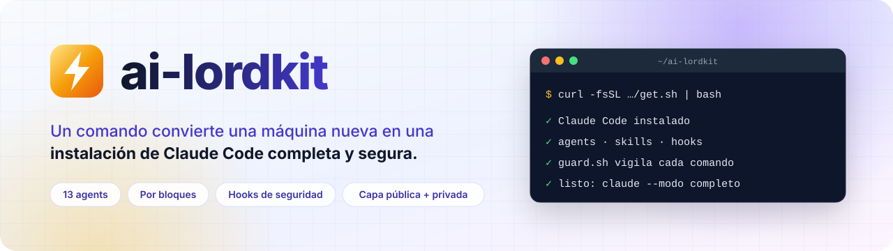
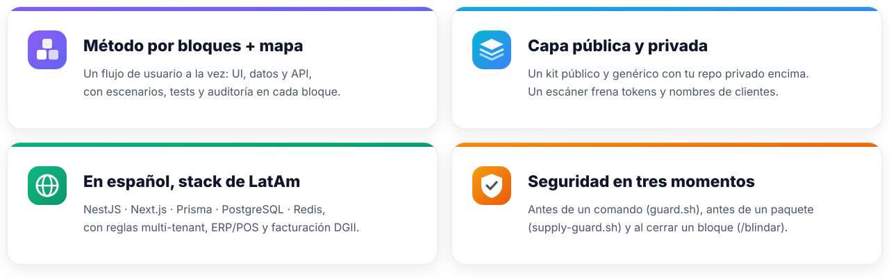
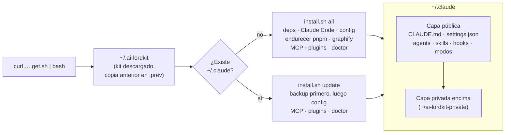
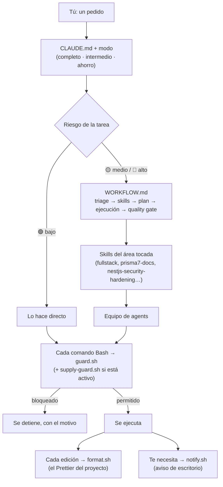
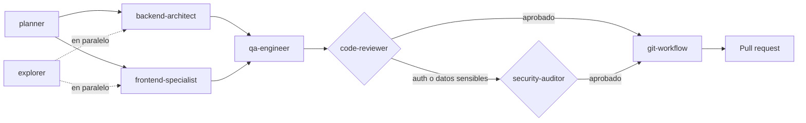
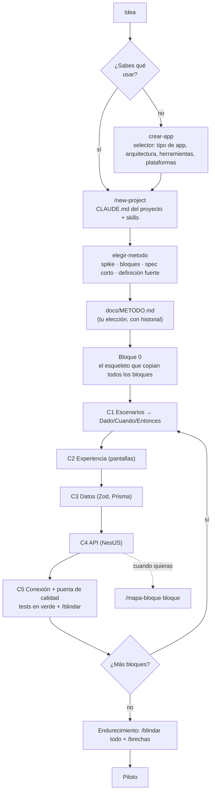
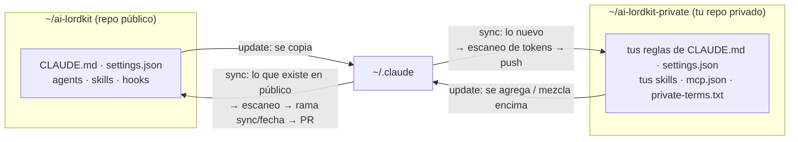

<div align="center">

<picture>
  <source media="(prefers-color-scheme: dark)" srcset="assets/banner-es-dark.svg">
  
</picture>

Agents, skills, hooks, modos de trabajo y servidores MCP para construir software real con IA, un bloque usable a la vez.

[](https://github.com/FrankLord27/ai-lordkit/actions/workflows/check.yml)
[](https://github.com/FrankLord27/ai-lordkit/actions/workflows/install.yml)
[](https://github.com/FrankLord27/ai-lordkit/releases)
[](LICENSE)
[](#-apoya-el-proyecto)

[English](README.md) · **Español**

<a href="https://github.com/sponsors/FrankLord27"></a>

</div>

```bash
curl -fsSL https://raw.githubusercontent.com/FrankLord27/ai-lordkit/main/get.sh | bash
```

> **No es un proyecto oficial de Anthropic.** Es una configuración comunitaria para [Claude Code](https://docs.anthropic.com/en/docs/claude-code), sin afiliación ni respaldo de Anthropic.

> Las instrucciones y skills están en **español**, y `CLAUDE.md` le dice a Claude que responda en español. Para usar otro idioma, agrega una línea como "Always answer in English" al `CLAUDE.md` de tu capa privada (se agrega al final, así que gana). Issues y PRs en español o inglés son bienvenidos.

## Contenido

- [Por qué existe](#-por-qué-existe)
- [Qué lo hace diferente](#-qué-lo-hace-diferente)
- [Inicio rápido](#-inicio-rápido)
- [Cómo funciona](#-cómo-funciona)
- [Estructura del repo](#-estructura-del-repo)
- [Referencia de comandos](#-referencia-de-comandos)
- [Skills](#-skills)
- [Equipo de agents](#-equipo-de-agents)
- [Hooks](#-hooks)
- [Modos de trabajo](#-modos-de-trabajo-completo-intermedio-ahorro)
- [Construir por bloques](#-construir-por-bloques)
- [Modelo de seguridad](#-modelo-de-seguridad)
- [Capa pública y capa privada](#-capa-pública-y-capa-privada)
- [Memoria entre sesiones](#-memoria-entre-sesiones)
- [Servidores MCP y conectores](#-servidores-mcp-y-conectores)
- [Plugins](#-plugins)
- [Detalles de instalación](#-detalles-de-instalación)
- [Sobre el autor](#-sobre-el-autor)
- [Apoya el proyecto](#-apoya-el-proyecto)
- [Contribuir y licencia](#-contribuir-y-licencia)

## 🎯 Por qué existe

Claude Code es potente desde el primer día, pero que trabaje **bien** requiere mucha configuración: instrucciones, permisos, hooks de seguridad, subagents, skills para tu stack, servidores MCP, plugins. Hacer eso a mano en cada máquina (y otra vez cada vez que formateas) es lento y fácil de hacer mal, de formas que cuestan dinero o filtran datos.

ai-lordkit nació como la configuración personal de un desarrollador fullstack que construye productos SaaS y sistemas para colegios con IA. Creció hasta ser un kit que cualquiera instala con un comando. Sus objetivos:

1. **Un comando, cualquier máquina.** Un Linux o macOS recién formateado (o Windows, nativo con Git Bash o con WSL) queda con Claude Code y toda la configuración en minutos. Correr el mismo comando otra vez lo actualiza.
2. **Seguro por defecto.** Claude Code puede ejecutar comandos en tu máquina. El kit bloquea los peligrosos (borrar tu carpeta personal, leer archivos `.env`, hacer push a `main`, `curl | sh`), endurece pnpm contra ataques de cadena de suministro y revisa tus dependencias contra avisos públicos.
3. **Productivo, no solo configurado.** Un equipo de 13 agents especializados, skills para un stack TypeScript moderno y un método que evita que la IA pierda el hilo en proyectos grandes.
4. **Barato cuando se puede.** Tres modos de trabajo cambian profundidad por tokens, y la línea de estado muestra cuánto cuesta cada sesión.
5. **Tuyo, sin exponerte.** Todo lo personal (clientes, proyectos, tokens, tus reglas) vive en una capa privada aparte que se aplica encima, y un escáner impide que llegue al repo público.

## ✨ Qué lo hace diferente

<picture>
  <source media="(prefers-color-scheme: dark)" srcset="assets/features-es-dark.svg">
  
</picture>

## 🚀 Inicio rápido

```bash
# 1. Instalar (Linux, macOS, Git Bash o Ubuntu dentro de WSL en Windows)
curl -fsSL https://raw.githubusercontent.com/FrankLord27/ai-lordkit/main/get.sh | bash

# 2. Abre una terminal nueva e inicia sesión
claude

# 3. Dentro de Claude Code, verifica que todo cargó
/agents      # los 13 subagents
/context     # lo que carga cada sesión
```

Después solo háblale. Algunas cosas para probar:

| Dices o escribes | Qué pasa |
| ---------------- | -------- |
| "quiero hacer una app para…" | `crear-app` muestra un selector con opciones de arquitectura y herramientas, y arranca el Bloque 0 |
| `/new-project` | Crea un proyecto con el estándar fullstack (pregunta nombre, tipo y si lleva app móvil) |
| `/mapa-bloque login` | Mapa HTML interactivo del bloque `login` en `docs/mapas/` |
| `/blindar` | Auditoría de seguridad del bloque que acabas de terminar, con correcciones e informe |
| `/brechas` | Revisa tus dependencias contra OSV.dev, CISA KEV y EPSS |
| `claude --modo ahorro` | Arranca una sesión más barata (Sonnet, effort bajo, respuestas cortas) |

## 🧭 Cómo funciona

### Instalar y actualizar



### Qué pasa en una sesión



### El equipo de agents en una feature



`code-reviewer` y `security-auditor` pueden bloquear. `git-workflow` es el único agent que commitea. Un fix trivial va directo a `git-workflow`; un hotfix va implementador → `qa-engineer` (smoke test) → `git-workflow` con el label `urgent`.

### Un proyecto, bloque a bloque



## 📁 Estructura del repo

```text
ai-lordkit/
├── get.sh                  # Instalador de un comando: baja el kit y corre install.sh
├── install.sh              # Instalar, actualizar, rollback, desinstalar, sync, scan… (ver Referencia de comandos)
├── CLAUDE.md               # Instrucciones globales, se cargan en cada sesión (cortas a propósito)
├── WORKFLOW.md             # Flujo detallado para tareas de riesgo medio/alto
├── CHECKLIST.md            # Pre-requisitos a mano: login de gh, identidad de git, commits firmados, protección de ramas
├── settings.json           # Permisos, hooks, línea de estado, marketplaces y plugins activos
├── agents/                 # 13 subagents (modelos por alias: opus, sonnet, haiku)
├── skills/                 # Skills: método, seguridad, estándar del stack, docs, memoria
├── commands/               # Slash commands: /new-project
├── output-styles/          # Modos de trabajo: completo, intermedio, ahorro
├── hooks/
│   ├── guard.sh            # Bloquea comandos peligrosos (PreToolUse en Bash)
│   ├── supply-guard.sh     # Opcional: revisa un paquete antes de instalarlo
│   ├── format.sh           # Formatea lo editado con el Prettier del proyecto
│   ├── notify.sh           # Aviso de escritorio cuando Claude te necesita (Linux, macOS, WSL, Git Bash)
│   ├── statusline.sh       # modelo · modo/effort · carpeta · rama · costo
│   └── test-guard.sh       # Tests de guard.sh
├── bin/
│   ├── shell-init.sh       # El wrapper `claude`: --modo y --kimi
│   └── claude-kimi         # La misma config con modelos de Kimi
├── mcp/servers.json        # Servidores MCP públicos, tokens como ${VARIABLES}
├── .claude-plugin/         # Marketplace que apunta a skills de terceros en su origen (SHAs fijos)
├── private-template/       # Plantilla de tu capa privada
├── scripts/
│   ├── scan-leaks.sh       # Escáner de fugas que usan verify, sync y CI
│   └── scan-allowlist.txt  # Coincidencias inofensivas conocidas
├── tests/                  # mapa-bloque, brechas, mem-search, modos, instalador (todo corre en CI)
└── .github/                # CI, plantillas de issues y PRs, FUNDING.yml
```

Después de instalar, las mismas piezas viven en `~/.claude/` (agents, skills, hooks, output styles, commands, `CLAUDE.md`, `settings.json`) y el wrapper en `~/.claude/shell-init.sh`, que se carga desde tu `.zshrc` o `.bashrc`.

## 💻 Referencia de comandos

### En la terminal: `get.sh`

```bash
# Instalar o actualizar (último release)
curl -fsSL https://raw.githubusercontent.com/FrankLord27/ai-lordkit/main/get.sh | bash

# Correr otro comando del instalador (doctor, verify, mcp…)
curl -fsSL https://raw.githubusercontent.com/FrankLord27/ai-lordkit/main/get.sh | bash -s -- doctor

# Una versión fija: un tag o, mejor, un SHA de commit (no puede cambiar por debajo)
curl -fsSL https://raw.githubusercontent.com/FrankLord27/ai-lordkit/<sha>/get.sh | AI_LORDKIT_REF=<sha> bash
```

| Variable          | Por defecto              | Qué hace                                                  |
| ----------------- | ------------------------ | --------------------------------------------------------- |
| `AI_LORDKIT_REF`  | último release (o `main` si no hay) | Rama, tag o SHA a instalar. Usa `main` para lo más nuevo sin publicar |
| `AI_LORDKIT_DIR`  | `~/.ai-lordkit`          | Dónde vive el kit. Si es un clon de git, no se toca       |
| `CLAUDE_YES`      | sin definir              | `1` confirma el paso de limpieza en máquinas sin terminal |
| `CLAUDE_PRIVATE_DIR` | `~/ai-lordkit-private` | Dónde vive tu capa privada                              |

### En la terminal: `install.sh`

Se corre desde la carpeta del kit (`~/.ai-lordkit`, o tu clon).

| Comando                     | Qué hace                                                              |
| --------------------------- | --------------------------------------------------------------------- |
| `./install.sh` (o `all`)    | Instalación completa para una máquina formateada: verify, deps, clean, instala Claude Code, aplica la config, harden, graphify, MCP, plugins, doctor |
| `./install.sh update`       | Aplica el kit (y tu capa privada) a `~/.claude` sin reinstalar Claude Code, con backup antes. También corre `mcp`, `plugins` y `doctor` |
| `./install.sh rollback`     | Devuelve la config que tenías antes del último `update` (córrelo otra vez para deshacer). `rollback <carpeta>` restaura un backup específico |
| `./install.sh uninstall`    | Quita lo que instaló el kit, con backup. Tu login, historial y proyectos se quedan |
| `./install.sh deps`         | Instala los pre-requisitos: git, gh, jq, Node 24, pnpm, uv (apt en Linux, Homebrew en macOS) |
| `./install.sh install`      | Solo descarga e instala Claude Code                                   |
| `./install.sh clean`        | **Mueve** `~/.claude` a `~/.claude-backups/<fecha>` y quita los binarios de Claude Code. No borra nada |
| `./install.sh restore`      | Como `update`, pensado para después de `clean` + `install`: recupera tu login, historial y proyectos |
| `./install.sh harden`       | Endurece pnpm (cuarentena de 7 días para versiones nuevas, scripts de instalación bloqueados) y verifica Node 24 |
| `./install.sh graphify`     | Instala graphify, el grafo de conocimiento del código que usa `/graphify` |
| `./install.sh mcp`          | Registra los servidores MCP de `mcp/servers.json` y de tu capa privada |
| `./install.sh plugins`      | Agrega los marketplaces e instala los plugins que activa `settings.json` |
| `./install.sh verify`       | Revisa el kit: estructura, tests de hooks, escáner de fugas, plugins declarados y cargados |
| `./install.sh doctor`       | Revisa git, gh, Node 24, pnpm, jq, uv, docker y la firma de commits   |
| `./install.sh private-init` | Crea tu capa privada en `~/ai-lordkit-private` desde `private-template/` |
| `./install.sh backup`       | Copia tu `~/.claude` vivo de vuelta al kit (lo que ya existe) y a tu capa privada (lo nuevo) |
| `./install.sh sync`         | `backup` + escaneo + commit + push: lo público en una rama `sync/<fecha>` para PR, lo privado directo |
| `./install.sh scan`         | Busca tokens, emails reales, rutas personales y tus términos privados |

### En la terminal: el wrapper `claude` y utilidades

| Comando | Qué hace |
| ------- | -------- |
| `claude` | Claude Code normal con tu suscripción de Anthropic |
| `claude --modo completo \| intermedio \| ahorro` | Arranca en un [modo de trabajo](#-modos-de-trabajo-completo-intermedio-ahorro): output style + effort (+ Sonnet en `ahorro`). Tu propio `--model` o `--effort` gana |
| `claude --kimi` (o `-k`) | Los mismos agents y skills con modelos de Kimi (necesita `KIMI_API_KEY` o `~/.claude/kimi.key`). Se combina con `--modo` |
| `claude-kimi --model k3-256k` | Llama al backend de Kimi directo con un modelo específico |
| `~/.claude/skills/mem-search/scripts/mem-search.sh -p <repo> "<regex>"` | Busca a mano en tus sesiones pasadas |
| `./hooks/test-guard.sh` | Prueba `guard.sh` después de cambiarlo |
| `./scripts/scan-leaks.sh` | Corre el escáner de fugas sobre el kit |

### Dentro de Claude Code

| Comando | Qué hace |
| ------- | -------- |
| `/new-project` | Proyecto nuevo con el estándar fullstack. Pregunta nombre, tipo (SaaS, marketplace, POS, sitio + admin, API…) y app móvil; escribe el `CLAUDE.md` del proyecto y carga las skills correctas. `/new-project mi-app saas movil` se salta las preguntas |
| `/mapa-bloque <bloque> [qué estudiar]` | Mapa interactivo de un bloque de código TypeScript en `docs/mapas/` (HTML, JSON, Markdown con Mermaid) |
| `/blindar [bloque \| carpeta]` | Auditoría de seguridad de un bloque: validación, rate limit, errores que filtran info, tokens y sesiones, CORS, rutas sin auth. Corrige con tests, informe en `docs/seguridad/` |
| `/blindar todo` | Auditoría de seguridad completa de 12 fases de todo el proyecto |
| `/brechas` | Avisos de dependencias: lockfile, servidores MCP y versión de Claude Code contra OSV.dev, CISA KEV y EPSS. Informe en `docs/seguridad/` |
| `/brechas noticias` | Agrega incidentes recientes (MCP, prompt injection, supply chain de npm) con enlace a la fuente |
| `/graphify .` | Construye un grafo de conocimiento del código (`graphify-out/`); las preguntas sobre el código lo usan primero |
| `/output-style <modo>` | Cambia el modo de trabajo dentro de la sesión (conserva la caché del prompt) |
| `/effort <nivel>` | Cambia cuánto piensa Claude |
| `/agents`, `/context`, `/memory` | Nativos: lista agents, muestra qué carga, edita la memoria automática |

La mayoría de las skills no necesitan comando: Claude las carga por su descripción cuando la tarea encaja (por ejemplo, `prisma7-docs` cuando tocas un schema de Prisma). Siempre puedes nombrarla: "usa la skill `erp-saas-core`".

## 🧩 Skills

**Método y arranque de proyecto**

| Skill | Qué hace |
| ----- | -------- |
| `crear-app` | "Quiero hacer una app" sin nada escogido: selector de tipo de app, arquitectura, herramientas y plataformas, cada opción con su contra. Guarda la elección en `docs/METODO.md` y arranca el Bloque 0 |
| `elegir-metodo` | Recomienda una forma de trabajar (spike, bloques, backend primero por módulo, spec corto, definición fuerte) con pros y contras; tú escoges y puedes cambiar después. Queda en `docs/METODO.md` |
| `desarrollo-por-etapas` | El ciclo por bloques: definición → Bloque 0 → un bloque a la vez (C1–C5) con puerta de calidad que pide evidencia → endurecimiento → piloto. Versiones cortas para features y bugs |
| `mapa-bloque` | Solo con `/mapa-bloque`: mapa de un bloque calculado por el compilador de TypeScript |
| `microservicios` | La opción de microservicios: cuándo NO usarla, gateway, una base de datos por servicio, contratos Zod compartidos, eventos con outbox, compose con health checks |
| `backend-quality-gate` | El método **backend primero por módulo**, una alternativa que puedes escoger en `elegir-metodo`. Va por módulo, no por capas de todo el sistema: cada módulo cierra primero su API (escenarios, tests, `/blindar`) y después sus pantallas siguen C2 y C5. La API probada se reutiliza en cualquier app encima |

**Seguridad**

| Skill | Qué hace |
| ----- | -------- |
| `blindar` | Auditoría de tu propio código, obligatoria al cerrar un bloque; `/blindar todo` para la auditoría completa |
| `brechas` | Vulnerabilidades conocidas y paquetes maliciosos en tus dependencias, servidores MCP y versión de Claude Code |
| `nestjs-security-hardening` | Base de seguridad para un backend NestJS: auth, validación, CSRF, cifrado, multi-tenant, logs |

**Estándar del stack y reglas de dominio**

| Skill | Qué hace |
| ----- | -------- |
| `fullstack` | El estándar: Next.js 16 + Tailwind v4, NestJS 11, Prisma 7, PostgreSQL 16, Redis, Zod compartido, Turborepo + pnpm, Expo cuando hay app móvil. 40 archivos de referencia (API, seguridad, testing, CI/CD, rendimiento, móvil…) |
| `erp-saas-core` | Reglas para ERP, SaaS multi-tenant y POS: arquitectura limpia, aislamiento de tenants, partida doble, precisión del dinero, idempotencia, colas, offline-first, facturación electrónica DGII |
| `skills-bundle` | Atajo que carga `erp-saas-core` y `memory-bank-context` juntos; `/new-project` lo usa en proyectos POS |
| `http-query-docs` | El método HTTP `QUERY` (RFC 10008) para búsquedas complejas, en vez de `POST /search` |
| `ui-ux-polish` | Convierte interfaces planas en otras con jerarquía, profundidad, micro-interacciones y movimiento |

**Referencias de librerías al día** (versiones que usa el kit)

`nestjs-docs` (NestJS 11) · `nextjs-docs` (Next.js 16) · `react-docs` (React 19.2) · `prisma7-docs` (Prisma 7) · `redis-docs` · `tailwind-docs` (Tailwind v4) · `tanstack-query-docs` (TanStack Query v5) · `zustand-docs` (Zustand 5) · `typescript-docs` (modo strict) · `docker-docs` · `minio-docs`. Para lo demás, el servidor MCP Context7 sirve la documentación oficial.

**Memoria y contexto**

| Skill | Qué hace |
| ----- | -------- |
| `mem-search` | Busca en tus sesiones pasadas ("¿qué decidimos de X?") con `rg`/`grep` + `jq`, gratis hasta que se usa |
| `memory-bank-context` | Seis archivos vivos por proyecto (brief, producto, patrones, técnica, contexto activo, progreso) para que una sesión nueva no arranque a ciegas |
| `graphify` | Grafo de conocimiento de un código o documentos, con herramientas de consulta, rutas y explicación |

**Otras**

| Skill | Qué hace |
| ----- | -------- |
| `prompt-master` | Escribe o mejora prompts para otras herramientas de IA, solo cuando se lo pides |

## 🤖 Equipo de agents

Los modelos van por alias, nunca por un ID fijo, así que siguen lo que sirva Claude Code. El trabajo rutinario (CRUD de entidades ya modeladas, unit tests de rutina) corre en Sonnet aunque el agent sea Opus.

| Agent | Modelo | Rol |
| ----- | ------ | --- |
| `planner` | sonnet | Divide un pedido en tareas pequeñas y dice qué agent toma cada una |
| `explorer` | haiku | Búsqueda rápida de solo lectura, para no ensuciar el contexto principal |
| `backend-architect` | opus | Schemas Prisma, módulos NestJS, contratos de API, auth, caché. Todo cambio de `schema.prisma` pasa por él |
| `frontend-specialist` | sonnet | Next.js 16 App Router, Tailwind v4, TanStack Query, React Hook Form + Zod |
| `qa-engineer` | opus | Tests unitarios (Jest), de integración (Supertest) y E2E (Playwright); tests en rojo primero para dinero y tenants |
| `code-reviewer` | sonnet | Revisa todo antes de un PR. **Puede bloquear** |
| `security-auditor` | opus | Solo seguridad: OWASP Top 10, auth, RBAC, fugas entre tenants, secretos. **Puede bloquear** |
| `db-migration-specialist` | opus | Migraciones de Prisma destructivas o complejas, con plan de rollback |
| `debugger` | sonnet | Causa raíz con evidencia, fix mínimo |
| `perf-optimizer` | sonnet | Queries N+1, índices, caché con Redis, tamaño del bundle, Core Web Vitals |
| `devops-engineer` | sonnet | Dockerfiles, compose, GitHub Actions, deploys a VPS |
| `readme-writer` | sonnet | README, CONTRIBUTING y `docs/` de tus proyectos |
| `git-workflow` | haiku | Ramas, Conventional Commits en español, PRs. **El único agent que commitea** |

## 🪝 Hooks

| Hook | Cuándo corre | Qué hace |
| ---- | ------------ | -------- |
| `guard.sh` | Antes de cada comando Bash | Bloquea borrar `/` o `$HOME`, tocar archivos de entorno o llaves, `printenv` completo, `curl \| sh`, contenedores privilegiados, force push y push a `main`. Si falta `jq`, bloquea |
| `supply-guard.sh` | Antes de `pnpm add`, `npm install`, `yarn add`, `npx`, `pnpm dlx`, `bunx` (**apagado por defecto**) | Bloquea una versión marcada como maliciosa y pregunta antes de una publicada hace menos de 7 días |
| `format.sh` | Después de cada edición | Formatea el archivo con el Prettier del proyecto. Nunca descarga Prettier |
| `notify.sh` | Cuando Claude te necesita | Aviso de escritorio en Linux, macOS, WSL y Git Bash |
| `statusline.sh` | Siempre | `Sonnet · ahorro/low · mi-repo · main · $0.12` |

## 🔋 Modos de trabajo: completo, intermedio, ahorro

Un modo junta un [output style](https://code.claude.com/docs/en/output-styles) (cómo habla Claude y qué tan a fondo trabaja) con un nivel de effort (cuánto piensa). Las dos son funciones nativas de Claude Code; no se parchea nada.

| Modo | Effort | Modelo | Qué cambia |
| ---- | ------ | ------ | ---------- |
| `completo` | `xhigh` | el tuyo | Verifica cada API que no domina con Context7 o la doc oficial, cubre casos borde, permisos y tenants, corre la suite completa, usa el equipo de agents y reporta lo que no pudo verificar. |
| `intermedio` | `medium` | el tuyo | Por defecto. Las reglas de `CLAUDE.md` tal cual. |
| `ahorro` | `low` | Sonnet | Habla lo mínimo, sin subagents ni búsquedas web salvo que hagan falta, comenta solo reglas de negocio no obvias, lee solo las líneas que necesita. Nunca recorta errores, tests fallidos ni avisos de seguridad. |

```bash
claude --modo ahorro              # al arrancar: output style + effort (+ Sonnet en ahorro)
claude --modo ahorro --model opus # tu propio --model o --effort gana
claude -k --modo completo         # también con el backend Kimi (no toca el modelo)
```

Dentro de una sesión: `/output-style ahorro` y `/effort low`. Cambiar el output style conserva la caché del prompt.

**Lo que de verdad ahorra tokens, en orden:** el modelo (Sonnet cuesta menos que Opus), el effort (el pensamiento se cobra como tokens de salida), cuántos subagents arrancan (cada uno empieza en frío) y cuánto contexto se lee. Respuestas más cortas y menos comentarios ayudan poco: el texto del chat es una parte pequeña de los tokens de una sesión. No hemos medido porcentajes, por eso la línea de estado muestra el costo y puedes comparar modos en tu propio trabajo. Los output styles no llegan a los subagents, que corren su propio prompt.

## 🧱 Construir por bloques

Los agentes de IA pierden el hilo cuando construyes una capa completa a la vez (todas las pantallas, luego toda la base de datos, luego toda la API). Este kit construye **por bloques**: un bloque es un flujo que un usuario puede terminar ("iniciar sesión", "inscribir un estudiante", "cobrar una factura"). Cada bloque cruza UI, datos y API, tiene un test de punta a punta y queda usable antes de empezar el siguiente.

**Primero los escenarios.** Antes de escribir código de un bloque, la IA escribe escenarios concretos: "la contadora del colegio necesita una tabla con todos los ingresos de octubre para cuadrar con el banco", con los pasos que sigue. De cada escenario salen las tareas del bloque y sus criterios Dado/Cuando/Entonces, y cada criterio se vuelve un test. El modo decide cuántos: de 2 a 4 en `completo` (con un caso de error y uno de permisos), de 1 a 3 en `intermedio`, 1 en `ahorro`.

**Tú escoges cómo trabajar.** La IA da su recomendación y sus razones, pero nunca impone un método: puedes tomar otra opción, proponer la tuya o cambiar de método en medio del proyecto (solo di "cambiemos a …"). No escribe código hasta que escojas, y cada cambio queda con fecha y motivo en el historial de `docs/METODO.md`.

**Seguridad en cada cierre.** `/blindar` es parte de la puerta C5: un bloque no está terminado hasta que pasa su auditoría. Al final, `/blindar todo` y `/brechas` cubren el proyecto completo.

Lo que muestra `/mapa-bloque`, todo calculado por el compilador, no adivinado por la IA:

- Qué archivos forman el bloque, su rol (módulo, controller, service, DTO, componente, hook…) y quién fuera del bloque los usa.
- Cada declaración de primer nivel de cada archivo y si se usa.
- Variables, imports y parámetros que nunca se leen, exports que nadie importa, archivos que nadie importa, código que solo usan los tests e imports circulares.

El mapa funciona sin internet. Trae su propio TypeScript 6 (TypeScript 7 ya no incluye la API de JavaScript que necesita); `./install.sh update` lo instala.

## 🔒 Modelo de seguridad

Claude Code corre en modo `auto`, así que hay capas:

1. **`permissions.allow`:** solo comandos de desarrollo concretos (`pnpm`, `git`, `gh`, `docker compose`, `npx prisma`…). Nada genérico que lea archivos cualesquiera (`cat`, `grep`), ejecute código arbitrario (`node *`, `python *`), copie archivos (`cp *`, `mv *`) o corra paquetes descargados (`npx *`, `docker *`).
2. **`permissions.ask`:** siempre pregunta antes de `curl`, `docker run`, `pnpm dlx`, `rm -rf`, `git reset --hard`, `prisma migrate reset`.
3. **`hooks/guard.sh`:** la última red, que bloquea aunque algo se haya aprobado: borrar `/` o `$HOME`, cualquier mención de un archivo de entorno (lo lea el programa que sea: `cat`, `node -e`, `python -c`…; escribir uno, `-f .env` y `--env-file` siguen permitidos), leer o enviar llaves, `printenv` completo, `curl | sh`, `docker run --privileged`, force push y push a `main` (incluido un `git push` pelado estando en main, y `git -C <dir> push`). Si falta `jq`, bloquea.
4. **`hooks/supply-guard.sh` (opcional, apagado por defecto):** antes de que Claude corra `pnpm add`, `npm install`, `yarn add`, `npx`, `pnpm dlx` o `bunx`, consulta cada paquete: una versión que OSV.dev marca como maliciosa se bloquea, y una publicada hace menos de 7 días te pregunta primero. Sin red deja pasar el comando (el `minimumReleaseAge` de pnpm sigue aplicando). Se activa con `"env": { "AI_LORDKIT_SUPPLY_GUARD": "1" }` en el `settings.json` de tu capa privada.
5. **pnpm endurecido** (`./install.sh harden`): las versiones nuevas esperan 7 días y los scripts de instalación se bloquean salvo que los permitas.

Para los paquetes que ya tienes, corre `/brechas`: revisa todo el lockfile (directas y transitivas), tus servidores MCP y tu versión de Claude Code contra OSV.dev, CISA KEV y EPSS, clasifica los hallazgos en crítico (malicioso o explotado activamente), alto, medio y bajo, y escribe `docs/seguridad/brechas-<fecha>.md` con la versión que corrige cada uno. Solo salen de tu máquina nombres y versiones de paquetes públicos; tus paquetes del workspace se saltan. Los riesgos aceptados van en `.brechas-ignorar` con su motivo y siguen apareciendo en el informe.

Si cambias `guard.sh`, corre `./hooks/test-guard.sh`. `./install.sh verify` también lo corre.

`guard.sh` compara texto, así que un truco decidido (armar el nombre del archivo por pedazos, por ejemplo) todavía puede pasarlo. Por eso los intérpretes no están en `allow`: la protección real es que Claude tenga que preguntar antes de ejecutar código arbitrario.

Fuera a propósito:

- **Documentación oficial:** la sirve el MCP de Context7, siempre al día.
- **Skills de Expo/EAS:** vienen del plugin oficial de Expo. Instálalo desde `/plugin` dentro de Claude Code.
- **Credenciales:** `~/.claude/.credentials.json`, `~/.claude/kimi.key` y cualquier archivo de entorno quedan fuera por `.gitignore` y por el escáner.

¿Encontraste una vulnerabilidad en el kit? Mira [SECURITY.md](SECURITY.md).

## 🔀 Capa pública y capa privada

Este repo es **genérico**: sin clientes, nombres de proyectos, emails ni tokens. Lo tuyo va en una **capa privada** que se aplica encima:



1. `./install.sh private-init` la crea desde `private-template/` y le hace `git init`.
2. Súbela a un repo **privado** tuyo. En otra máquina, clónala en `~/ai-lordkit-private` antes de instalar (o apunta `CLAUDE_PRIVATE_DIR` a ella).
3. `./install.sh update` aplica la capa pública y luego la privada: tu `CLAUDE.md` se agrega al final, `settings.json` se mezcla (los arrays de permisos se suman) y tus skills, agents y commands se copian.

`./install.sh sync` va en sentido contrario sin mezclarlas:

- Lo que ya existe en el repo público vuelve a él. **Lo nuevo va a la capa privada.** Para publicar una skill nueva, muévela tú.
- `settings.json` nunca se copia de vuelta automáticamente, porque el vivo puede tener tokens en `env`.
- Antes de subir el lado público corre el escáner. Un token, un email real, una ruta `/home/<usuario>` o una palabra de tu `private-terms.txt` aborta el sync.
- El lado público se sube a una rama `sync/<fecha>` para que pase por un PR, nunca directo a `main`.
- El lado privado también se escanea: ahí los nombres están bien, los tokens no.

## 🧠 Memoria entre sesiones

Sin servidor de memoria extra, sin worker y sin costo de API. Tres piezas:

- **Memoria automática de Claude Code** (nativa, activa por defecto): Claude guarda notas por repo en `MEMORY.md` y carga solo las primeras 200 líneas en cada sesión. Abre `/memory` para verlas o editarlas.
- **Skill `mem-search`**: busca en tus sesiones pasadas (`~/.claude/projects/*/*.jsonl`) con `rg`/`grep` + `jq`. Solo lee lo que escribiste y las respuestas de Claude, sin la salida de herramientas ni el pensamiento, y no cuesta nada hasta que Claude la usa. Pruébala tú: `~/.claude/skills/mem-search/scripts/mem-search.sh -p mi-repo "tenantId|multi.?tenant"`.
- **Historial de sesiones por un año:** `cleanupPeriodDays` es 365 en `settings.json` (el de Claude Code es 30), así hay qué buscar. Bájalo en tu capa privada si el disco importa.

Para el estado del proyecto, la skill `memory-bank-context` y `graphify` cubren el resto.

**¿Vienes de claude-mem?** El kit ya no lo instala: su observador en la nube ahora es una suscripción paga, y sin él la compresión corre en tu propio plan de Claude. Quítalo con `claude plugin uninstall claude-mem@thedotmack`. Sus datos quedan en `~/.claude-mem/` hasta que los borres. `./install.sh doctor` avisa si sigue instalado.

## 🔌 Servidores MCP y conectores

`mcp/servers.json` lista los servidores MCP que se instalan para todos. Los tokens nunca viven en el archivo: se escriben como `${VARIABLE}` y se leen de tu entorno cuando corres `./install.sh mcp`. Si falta una variable, ese servidor se salta.

| Servidor   | Necesita                                                                       |
| ---------- | ------------------------------------------------------------------------------ |
| `context7` | Nada. Documentación oficial de librerías al día                                |
| `github`   | `GITHUB_MCP_TOKEN`: tu propio token fine-grained de GitHub, con los permisos que escojas |

Los servidores MCP privados (tu proveedor de hosting, por ejemplo) van en el `mcp.json` de tu capa privada, mismo formato. El valor del token solo termina en el `~/.claude.json` de esa máquina, que `sync` nunca toca.

**Los conectores de claude.ai** (Gmail, Drive, Notion, Slack…) no se pueden exportar: son de cada cuenta. Conecta los tuyos en claude.ai, en Settings → Connectors.

## 🧰 Plugins

El kit no copia skills ajenas. `settings.json` declara los marketplaces en `extraKnownMarketplaces` y activa plugins en `enabledPlugins`, así cada máquina los baja de su origen y se siguen actualizando (`autoUpdate: true`).

**Activos por defecto** (útiles en cualquier proyecto TypeScript/Prisma, baratos en contexto):

| Plugin | Marketplace | Qué agrega |
| ------ | ----------- | ---------- |
| `prisma` | `claude-plugins-official` | Servidores MCP de Prisma (local y Prisma Postgres) |
| `typescript-lsp` | `claude-plugins-official` | Servidor de lenguaje de TypeScript: ir a la definición, diagnósticos. Necesita `typescript-language-server` en tu `PATH` |
| `security-guidance` | `claude-plugins-official` | Hooks que avisan de patrones inseguros mientras Claude edita |
| `claude-md-management` | `claude-plugins-official` | Auditar y mejorar archivos `CLAUDE.md` |
| `playwright` | `claude-plugins-official` | MCP de Playwright: maneja un navegador real |
| `skill-creator` | `claude-plugins-official` | La skill de Anthropic para escribir y probar skills ([anthropics/skills](https://github.com/anthropics/skills)) |
| `react-best-practices` | `ai-lordkit` | [vercel-labs/agent-skills](https://github.com/vercel-labs/agent-skills): reglas de rendimiento de React y Next.js |
| `composition-patterns` | `ai-lordkit` | vercel-labs/agent-skills: patrones de composición de React |
| `web-design-guidelines` | `ai-lordkit` | vercel-labs/agent-skills: revisa la UI contra las Web Interface Guidelines |

**Apagados por defecto** (declarados como `false`; activa los que uses en tu capa privada):

| Plugin | Por qué está apagado |
| ------ | -------------------- |
| `sentry`, `vercel`, `hostinger` | Solo sirven si usas ese servicio, y cada uno carga sus herramientas MCP en cada sesión |
| `pr-review-toolkit`, `commit-commands` | Se solapan con los agents `code-reviewer` y `git-workflow` del kit |
| `hookify` | Corre un script de Python en cada llamada a una herramienta |
| `superpowers` | Trae su propio proceso (brainstorm antes de todo, "usa siempre una skill") que choca con el `WORKFLOW.md` del kit, y se inyecta en cada sesión |

Para activar uno, agrégalo al `settings.json` de tu capa privada:

```json
{ "enabledPlugins": { "sentry@claude-plugins-official": true } }
```

Si instalaste el kit antes de este cambio, esos plugins siguen instalados en tu máquina; `update` ahora los marca como apagados. Revisa lo que carga cada sesión con `/context`.

De dónde viene cada uno:

- **`claude-plugins-official`** ([anthropics/claude-plugins-official](https://github.com/anthropics/claude-plugins-official)) es el marketplace de Anthropic. Ya lista `superpowers`, `context7` y `skill-creator`, así que el kit usa esas entradas en vez de agregar `obra/superpowers`, `upstash/context7` o `anthropics/skills` como marketplaces aparte.
- **`ai-lordkit`** es [`.claude-plugin/marketplace.json`](.claude-plugin/marketplace.json) en este repo. `vercel-labs/agent-skills` no es un marketplace de Claude Code, así que este catálogo apunta a la carpeta de cada skill en su origen (fuente `git-subdir`). Solo se clona ese archivo (`sparsePaths`). Cada entrada está fijada a un commit de origen (`sha`), así un cambio allá no llega a tu máquina hasta que el kit lo sube a propósito.
- **Context7** no está activo como plugin porque `mcp/servers.json` ya instala el mismo servidor. Dos copias solo duplicarían herramientas.

`./install.sh plugins` (también parte de `all` y `update`) agrega los marketplaces e instala lo que falte. Claude Code registraría los marketplaces solo en la siguiente sesión interactiva, pero no desde scripts, así que lo hace el instalador. `./install.sh verify` falla si el marketplace de un plugin no está declarado o si un plugin repite otro plugin, una skill del kit o un servidor MCP, y en una máquina con Claude Code avisa de plugins que no están instalados, están apagados o fallaron al cargar.

Más plugins no es mejor: cada plugin activo agrega herramientas y descripciones de skills a cada sesión, y Claude escoge peor con demasiados. Para agregar los tuyos o apagar uno, usa el `settings.json` de tu capa privada, que se mezcla encima: `"vercel@claude-plugins-official": false` en `enabledPlugins` lo apaga en tus máquinas. `claude plugin disable` solo no dura, porque `update` vuelve a escribir `settings.json`.

En sesiones en la nube (claude.ai/code) los plugins de los archivos de settings no cargan; esta lista aplica a tus máquinas (ver [Sesiones en la nube](#sesiones-en-la-nube-claudeaicode)).

## 📦 Detalles de instalación

`get.sh` baja el kit a `~/.ai-lordkit` y corre su instalador:

- **Sin `~/.claude` todavía** → instalación completa: dependencias (apt en Linux, Homebrew en macOS), Claude Code, la config, endurecimiento de pnpm y los servidores MCP.
- **`~/.claude` ya existe** → `update`: solo aplica la config, con backup de tus archivos antes.

Al terminar, abre una terminal nueva, corre `claude` e inicia sesión. Si crea un `~/.zshrc` nuevo (un Mac recién formateado no trae), es para poner `~/.local/bin` en tu `PATH` y activar `claude --kimi`. Correr el mismo comando otra vez actualiza el kit (la copia anterior queda en `~/.ai-lordkit.prev`).

Antes de la primera instalación, [CHECKLIST.md](CHECKLIST.md) lista lo que vale la pena configurar a mano: `gh auth login`, tu identidad de git, commits firmados y protección de ramas en tus repos. `./install.sh doctor` te dice cuáles faltan.

### Actualizar conserva tus ajustes

`update` no sobrescribe `~/.claude/settings.json`. Las claves que declara el kit se escriben encima de las tuyas (así un permiso que el kit quitó no se queda), y todo lo que el kit no declara se queda: tu `statusLine`, tus variables de `env`, un plugin que instalaste a mano. `CLAUDE.md` lo genera el kit, así que pon tus reglas en tu capa privada. Si un update rompe algo, `./install.sh rollback` trae la config anterior.

### Windows

Dos caminos, los dos soportados:

**Nativo (Git Bash, recomendado)** — es el shell que usa el propio Claude Code en Windows.

1. Instala [Git for Windows](https://git-scm.com/download/win) (trae Git Bash).
2. Abre **Git Bash** y corre el comando de instalación de arriba. `deps` usa `winget` (sin admin para jq, gh y uv; Node lo pide una vez): `jq`, `gh`, Node 24 LTS y `uv`. pnpm llega por `corepack` a `~/.local/bin`.
3. Si instaló programas, cierra y abre Git Bash y corre `./install.sh deps` otra vez para que tome el PATH nuevo.

Lo que el kit resuelve por ti en Windows: los scripts siempre quedan con saltos de línea LF (`.gitattributes`, aun con `core.autocrlf=true`), las rutas `C:\...` que manda Claude Code se convierten para los hooks, se quita el CRLF que escribe `jq.exe`, y `guard.sh` también bloquea `rm -rf` sobre la raíz de una unidad (`C:\`, `/c/`) y sobre tu carpeta de usuario. Las notificaciones salen como globo de Windows. `chmod 600` sobre `kimi.key` no hace nada en NTFS: deja ese archivo solo en tu perfil de usuario.

**WSL** — si prefieres un entorno Linux:

1. En PowerShell como administrador: `wsl --install` (instala Ubuntu) y reinicia.
2. Abre **Ubuntu** desde el menú Inicio y corre el comando de instalación de arriba dentro.
3. Deja tu código dentro de WSL (`~/code`, no `/mnt/c/...`): el acceso a archivos entre los dos lados es lento.

### Sesiones en la nube (claude.ai/code)

Las sesiones en la nube arrancan en un contenedor nuevo, así que nada de tu máquina está ahí. Lo que sí carga:

- **Tu cuenta de claude.ai:** las skills y plugins que subes a tu cuenta se sincronizan en cada sesión en la nube. Esa es la forma confiable de tener tus skills ahí.
- **El repo que abres:** su `CLAUDE.md` y su carpeta `.claude/`.

Los plugins del `settings.json` del kit no cargan en la nube. Puedes probar correr el instalador desde el **setup script** del entorno en la nube (`curl -fsSL .../get.sh | CLAUDE_YES=1 bash -s -- update`), pero todavía no está probado si la sesión toma un `~/.claude` hecho así. Si lo pruebas, abre un issue con el resultado.

Mantén también tu cuenta liviana: cada plugin y conector activo en tu cuenta se carga en cada sesión en la nube, y eso cuesta contexto.

### Revísalo antes de correrlo

Pasar un script a `bash` es confiar en él. Para leerlo antes:

```bash
curl -fsSL https://raw.githubusercontent.com/FrankLord27/ai-lordkit/main/get.sh -o get.sh
less get.sh        # ~85 líneas: baja un tarball y corre install.sh
bash get.sh
```

`get.sh` solo baja el kit y corre `install.sh`, así que revisa ese también ([install.sh](install.sh)). Todo el script está dentro de una función, así que una descarga cortada nunca corre la mitad.

### Instalar desde un clon

Si quieres contribuir o usar `backup` / `sync` (necesitan un repo de git):

```bash
git clone https://github.com/FrankLord27/ai-lordkit ~/ai-lordkit && ~/ai-lordkit/install.sh
```

La instalación completa **mueve** tu `~/.claude` actual a `~/.claude-backups/` primero (no se borra nada). ¿Ya tienes Claude Code y solo quieres la config? Corre `./install.sh update` (hace backup antes).

## 👨‍💻 Sobre el autor

<table>
  <tr>
    <td width="120" align="center">
      <a href="https://github.com/FrankLord27"></a>
    </td>
    <td>
      <strong>Frank Felix Rodriguez Canario</strong><br>
      <a href="https://github.com/FrankLord27"></a>
      <a href="https://www.linkedin.com/in/frank-f%C3%A9lix-rodr%C3%ADguez-22ab42114/"></a><br>
      Desarrollador fullstack y técnico de IT de 🇩🇴 República Dominicana. Construyo mis propios productos SaaS y sistemas para colegios con NestJS, Next.js, TypeScript, Prisma y PostgreSQL, y uso IA todos los días para construirlos.<br><br>
      ai-lordkit es la configuración que me hubiera gustado tener cuando empecé: un comando, valores seguros por defecto y un método que mantiene a la IA en carril en proyectos grandes.
    </td>
  </tr>
</table>

## 💖 Apoya el proyecto

ai-lordkit es gratis y con licencia MIT, y así se va a quedar. Lo construyo en mi tiempo libre, y las donaciones van directo a construir más herramientas abiertas para desarrollar con IA: skills nuevas, mejores chequeos de seguridad y mantener todo al día mientras Claude Code cambia.

Si te ahorra tiempo, cualquier ayuda se agradece de corazón:

<p align="center">
  <a href="https://github.com/sponsors/FrankLord27"></a>
  &nbsp;
  <a href="https://www.paypal.me/frankfelixr"></a>
</p>

- **[GitHub Sponsors](https://github.com/sponsors/FrankLord27)**: niveles mensuales de $3 (Coffee), $10 (Supporter) y $25 (Backer), un monto a tu gusto o una donación única. También con el botón Sponsor arriba en este repo.
- **[PayPal](https://www.paypal.me/frankfelixr)**: donaciones únicas de cualquier monto.
- **Una ⭐ al repo** y compartirlo con otros desarrolladores también ayuda, y no cuesta nada.

¡Gracias! 🙏

## 🤝 Contribuir y licencia

Issues y pull requests son bienvenidos, en español o inglés. Lee primero [CONTRIBUTING.md](CONTRIBUTING.md): el kit tiene que seguir siendo genérico (sin nombres de clientes ni proyectos) y `./install.sh verify` tiene que pasar. Los cambios se listan en [CHANGELOG.md](CHANGELOG.md). Los problemas de seguridad van por [SECURITY.md](SECURITY.md), no por issues públicos.

Licencia [MIT](LICENSE).
