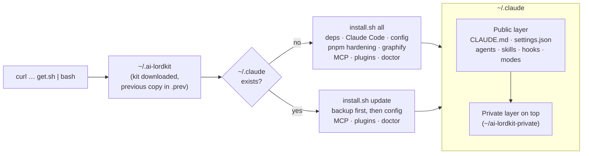
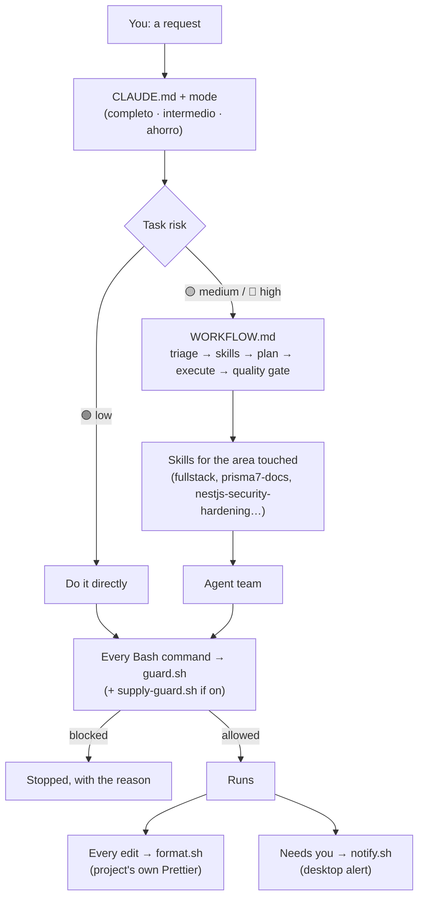
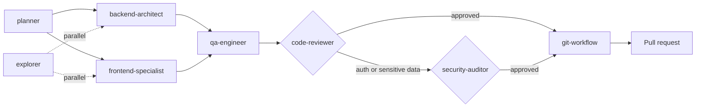
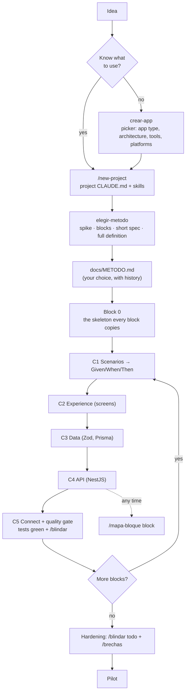
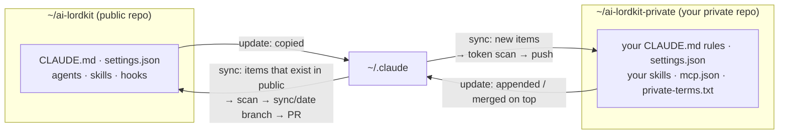

<div align="center">

# ⚡ ai-lordkit

**One command turns a fresh machine into a complete, safe and productive Claude Code setup.**

Agents, skills, hooks, work modes and MCP servers for building real software with AI, one usable block at a time.

[](https://github.com/FrankLord27/ai-lordkit/actions/workflows/check.yml)
[](https://github.com/FrankLord27/ai-lordkit/actions/workflows/install.yml)
[](https://github.com/FrankLord27/ai-lordkit/releases)
[](LICENSE)
[](#-support-the-project)

**English** · [Español](README.es.md)

</div>

```bash
curl -fsSL https://raw.githubusercontent.com/FrankLord27/ai-lordkit/main/get.sh | bash
```

> **Not an official Anthropic project.** This is a community setup for [Claude Code](https://docs.anthropic.com/en/docs/claude-code). It is not affiliated with or endorsed by Anthropic.

> Instructions and skills are written in **Spanish**, and `CLAUDE.md` tells Claude to answer in Spanish. To use another language, add a line like "Always answer in English" to your private layer's `CLAUDE.md` (it's appended last, so it wins). Issues and PRs in English or Spanish are welcome.

## Contents

- [Why this exists](#-why-this-exists)
- [What makes it different](#-what-makes-it-different)
- [Quick start](#-quick-start)
- [How it works](#-how-it-works)
- [Repository structure](#-repository-structure)
- [Command reference](#-command-reference)
- [Skills](#-skills)
- [Agent team](#-agent-team)
- [Hooks](#-hooks)
- [Work modes](#-work-modes-completo-intermedio-ahorro)
- [Building by blocks](#-building-by-blocks)
- [Security model](#-security-model)
- [Public layer and private layer](#-public-layer-and-private-layer)
- [Memory across sessions](#-memory-across-sessions)
- [MCP servers and connectors](#-mcp-servers-and-connectors)
- [Plugins](#-plugins)
- [Installation details](#-installation-details)
- [About the author](#-about-the-author)
- [Support the project](#-support-the-project)
- [Contributing and license](#-contributing-and-license)

## 🎯 Why this exists

Claude Code is powerful out of the box, but getting it to work **well** takes a lot of setup: instructions, permissions, safety hooks, subagents, skills for your stack, MCP servers, plugins. Doing that by hand on every machine (and again after formatting one) is slow, and easy to get wrong in ways that cost money or leak data.

ai-lordkit started as the personal setup of a fullstack developer building SaaS products and school systems with AI. It grew into a kit anyone can install with one command. Its goals:

1. **One command, any machine.** A freshly formatted Linux or macOS machine (or Windows through WSL) gets Claude Code plus the whole configuration in minutes. Running the command again updates it.
2. **Safe by default.** Claude Code can run commands on your machine. The kit blocks the dangerous ones (deleting your home folder, reading `.env` files, pushing to `main`, `curl | sh`), hardens pnpm against supply-chain attacks and checks your dependencies against public advisories.
3. **Productive, not just configured.** A team of 13 specialized agents, skills for a modern TypeScript stack and a method that keeps the AI from losing the thread on big projects.
4. **Cheap when it can be.** Three work modes trade depth for tokens, and the status line shows what each session costs.
5. **Yours, without leaking you.** Everything personal (clients, projects, tokens, your own rules) lives in a separate private layer applied on top, and a scanner stops it from ever reaching the public repo.

## ✨ What makes it different

| | |
| --- | --- |
| 🧱 **Block method + block map** | The AI builds one user flow at a time ("log in", "charge an invoice") through UI, data and API, with scenarios, tests and a security audit at each block's close. `/mapa-bloque` draws any block from the TypeScript compiler: unused code, dead exports and import cycles in red. |
| 🔐 **Public / private layers with a leak scanner** | One public, generic kit; your private repo on top. `sync` sends each change back to the right layer and refuses to push tokens, emails, home paths or words from your `private-terms.txt`. |
| 🌎 **Spanish-first, LatAm stack** | Instructions in Spanish for NestJS 11 + Next.js 16 + Prisma 7 + PostgreSQL + Redis, with rules for multi-tenant SaaS, ERP/POS, double-entry accounting and Dominican electronic invoicing (DGII). |
| 🛡️ **Security at three moments** | Before a command runs (`guard.sh`), before a package is installed (`supply-guard.sh`, optional) and when a block closes (`/blindar`, `/brechas`). |

## 🚀 Quick start

```bash
# 1. Install (Linux, macOS, or Ubuntu inside WSL on Windows)
curl -fsSL https://raw.githubusercontent.com/FrankLord27/ai-lordkit/main/get.sh | bash

# 2. Open a new terminal and log in
claude

# 3. Inside Claude Code, check that everything loaded
/agents      # the 13 subagents
/context     # what each session loads
```

Then just talk to it. A few things to try:

| You say or type | What happens |
| --------------- | ------------ |
| "quiero hacer una app para…" | `crear-app` shows a clickable picker for architecture and tools, then starts Block 0 |
| `/new-project` | Creates a project with the fullstack standard (asks name, type and whether it has a mobile app) |
| `/mapa-bloque login` | Interactive HTML map of the `login` block in `docs/mapas/` |
| `/blindar` | Security audit of the block you just finished, with fixes and a report |
| `/brechas` | Checks your dependencies against OSV.dev, CISA KEV and EPSS |
| `claude --modo ahorro` | Starts a cheaper session (Sonnet, low effort, short answers) |

## 🧭 How it works

### Install and update



### What happens in a session



### The agent team on a feature



`code-reviewer` and `security-auditor` can block. `git-workflow` is the only agent that commits. A trivial fix goes straight to `git-workflow`; a hotfix goes implementer → `qa-engineer` (smoke test) → `git-workflow` with the `urgent` label.

### A project, block by block



## 📁 Repository structure

```text
ai-lordkit/
├── get.sh                  # One-command installer: downloads the kit and runs install.sh
├── install.sh              # Install, update, rollback, uninstall, sync, scan… (see Command reference)
├── CLAUDE.md               # Global instructions, loaded in every session (kept short on purpose)
├── WORKFLOW.md             # Detailed flow for medium/high-risk tasks
├── CHECKLIST.md            # Prerequisites by hand: gh login, git identity, signed commits, branch protection
├── settings.json           # Permissions, hooks, status line, plugin marketplaces, enabled plugins
├── agents/                 # 13 subagents (models by alias: opus, sonnet, haiku)
├── skills/                 # Skills: method, security, stack standard, docs, memory
├── commands/               # Slash commands: /new-project
├── output-styles/          # Work modes: completo, intermedio, ahorro
├── hooks/
│   ├── guard.sh            # Blocks dangerous commands (PreToolUse on Bash)
│   ├── supply-guard.sh     # Optional: checks a package before installing it
│   ├── format.sh           # Formats edited files with the project's own Prettier
│   ├── notify.sh           # Desktop alert when Claude needs you (Linux, macOS, WSL)
│   ├── statusline.sh       # model · mode/effort · folder · branch · cost
│   └── test-guard.sh       # Tests for guard.sh
├── bin/
│   ├── shell-init.sh       # The `claude` wrapper: --modo and --kimi
│   └── claude-kimi         # Same config on Kimi models
├── mcp/servers.json        # Public MCP servers, tokens as ${VARIABLES}
├── .claude-plugin/         # Marketplace that points to third-party skills upstream (pinned SHAs)
├── private-template/       # Template for your private layer
├── scripts/
│   ├── scan-leaks.sh       # Leak scanner used by verify, sync and CI
│   └── scan-allowlist.txt  # Known-safe matches for the scanner
├── tests/                  # mapa-bloque, brechas, mem-search, modes, installer (all run in CI)
└── .github/                # CI, issue and PR templates, FUNDING.yml
```

After installing, the same pieces live in `~/.claude/` (agents, skills, hooks, output styles, commands, `CLAUDE.md`, `settings.json`) and the wrapper in `~/.claude/shell-init.sh`, loaded from your `.zshrc` or `.bashrc`.

## 💻 Command reference

### In the terminal: `get.sh`

```bash
# Install or update (latest release)
curl -fsSL https://raw.githubusercontent.com/FrankLord27/ai-lordkit/main/get.sh | bash

# Run another installer command (doctor, verify, mcp…)
curl -fsSL https://raw.githubusercontent.com/FrankLord27/ai-lordkit/main/get.sh | bash -s -- doctor

# A fixed version: a tag, or better, a commit SHA (it can't change under you)
curl -fsSL https://raw.githubusercontent.com/FrankLord27/ai-lordkit/<sha>/get.sh | AI_LORDKIT_REF=<sha> bash
```

| Variable          | Default                  | What it does                                              |
| ----------------- | ------------------------ | --------------------------------------------------------- |
| `AI_LORDKIT_REF`  | latest release (or `main` if there is none) | Branch, tag or commit SHA to install. Use `main` for the newest unreleased changes |
| `AI_LORDKIT_DIR`  | `~/.ai-lordkit`          | Where the kit lives. If it is a git clone, it isn't touched |
| `CLAUDE_YES`      | unset                    | `1` confirms the cleanup step on machines without a terminal |
| `CLAUDE_PRIVATE_DIR` | `~/ai-lordkit-private` | Where your private layer lives                           |

### In the terminal: `install.sh`

Run from the kit folder (`~/.ai-lordkit`, or your clone).

| Command                     | What it does                                                          |
| --------------------------- | --------------------------------------------------------------------- |
| `./install.sh` (or `all`)   | Full setup for a formatted machine: verify, deps, clean, install Claude Code, apply the config, harden, graphify, MCP, plugins, doctor |
| `./install.sh update`       | Applies the kit (and your private layer) to `~/.claude` without reinstalling Claude Code, with a backup first. Also runs `mcp`, `plugins` and `doctor` |
| `./install.sh rollback`     | Puts back the config you had before the last `update` (run it again to undo). `rollback <folder>` restores a specific backup |
| `./install.sh uninstall`    | Removes what the kit installed, with a backup. Your login, history and projects stay |
| `./install.sh deps`         | Installs the prerequisites: git, gh, jq, Node 24, pnpm, uv (apt on Linux, Homebrew on macOS) |
| `./install.sh install`      | Only downloads and installs Claude Code                               |
| `./install.sh clean`        | **Moves** `~/.claude` to `~/.claude-backups/<date>` and removes the Claude Code binaries. Nothing is deleted |
| `./install.sh restore`      | Like `update`, meant for right after `clean` + `install`: brings back your login, history and projects |
| `./install.sh harden`       | pnpm supply-chain hardening (7-day quarantine for new versions, install scripts blocked) and a Node 24 check |
| `./install.sh graphify`     | Installs graphify, the code knowledge graph used by `/graphify`       |
| `./install.sh mcp`          | Registers the MCP servers from `mcp/servers.json` and your private layer |
| `./install.sh plugins`      | Adds the plugin marketplaces and installs the plugins `settings.json` enables |
| `./install.sh verify`       | Checks the kit: structure, hook tests, leak scanner, plugins declared and loaded |
| `./install.sh doctor`       | Checks git, gh, Node 24, pnpm, jq, uv, docker, commit signing        |
| `./install.sh private-init` | Creates your private layer in `~/ai-lordkit-private` from `private-template/` |
| `./install.sh backup`       | Copies your live `~/.claude` back into the kit (existing items) and your private layer (new items) |
| `./install.sh sync`         | `backup` + scan + commit + push: public side on a `sync/<date>` branch for a PR, private side directly |
| `./install.sh scan`         | Looks for tokens, real emails, personal paths and your private terms  |

### In the terminal: `claude` wrapper and helpers

| Command | What it does |
| ------- | ------------ |
| `claude` | Normal Claude Code with your Anthropic subscription |
| `claude --modo completo \| intermedio \| ahorro` | Starts in a [work mode](#-work-modes-completo-intermedio-ahorro): output style + effort (+ Sonnet in `ahorro`). Your own `--model` or `--effort` wins |
| `claude --kimi` (or `-k`) | Same agents and skills on Kimi models (needs `KIMI_API_KEY` or `~/.claude/kimi.key`). Combines with `--modo` |
| `claude-kimi --model k3-256k` | Calls the Kimi backend directly with a specific Kimi model |
| `~/.claude/skills/mem-search/scripts/mem-search.sh -p <repo> "<regex>"` | Searches your past sessions by hand |
| `./hooks/test-guard.sh` | Tests `guard.sh` after you change it |
| `./scripts/scan-leaks.sh` | Runs the leak scanner on the kit |

### Inside Claude Code

| Command | What it does |
| ------- | ------------ |
| `/new-project` | New project with the fullstack standard. Asks name, type (SaaS, marketplace, POS, site + admin, API…) and mobile app; writes the project's `CLAUDE.md` and loads the right skills. `/new-project my-app saas movil` skips the questions |
| `/mapa-bloque <block> [what to study]` | Interactive map of a block of TypeScript code in `docs/mapas/` (HTML, JSON, Markdown with Mermaid) |
| `/blindar [block \| folder]` | Security audit of a block: validation, rate limits, error leaks, tokens and sessions, CORS, routes without auth. Fixes with tests, report in `docs/seguridad/` |
| `/blindar todo` | Full 12-phase security audit of the whole project |
| `/brechas` | Dependency advisories: lockfile, MCP servers and Claude Code version against OSV.dev, CISA KEV and EPSS. Report in `docs/seguridad/` |
| `/brechas noticias` | Adds recent incidents (MCP, prompt injection, npm supply chain) with source links |
| `/graphify .` | Builds a knowledge graph of the codebase (`graphify-out/`); later questions about the code use it first |
| `/output-style <mode>` | Switches the work mode inside a session (keeps the prompt cache) |
| `/effort <level>` | Changes how much Claude thinks |
| `/agents`, `/context`, `/memory` | Built-in: list agents, see what loads, edit auto memory |

Most skills don't need a command: Claude loads them by their description when the task matches (for example, `prisma7-docs` when you touch a Prisma schema). You can always name one: "usa la skill `erp-saas-core`".

## 🧩 Skills

**Method and project start**

| Skill | What it does |
| ----- | ------------ |
| `crear-app` | "I want to build an app" with nothing picked yet: clickable picker for app type, architecture, tools and platforms, each option with its main drawback. Saves the choice in `docs/METODO.md` and starts Block 0 |
| `elegir-metodo` | Recommends a way of working (spike, blocks, short spec, full definition) with pros and cons; you pick and can switch later. Logged in `docs/METODO.md` |
| `desarrollo-por-etapas` | The block cycle: definition → Block 0 → one block at a time (C1–C5) with a quality gate that needs evidence → hardening → pilot. Short versions for features and bugs |
| `mapa-bloque` | Only on `/mapa-bloque`: map of a block computed by the TypeScript compiler |
| `microservicios` | The microservices option: when NOT to use it, gateway, a database per service, shared Zod contracts, events with an outbox, compose with health checks |

**Security**

| Skill | What it does |
| ----- | ------------ |
| `blindar` | Audit of your own code, mandatory when a block closes; `/blindar todo` for the full audit |
| `brechas` | Known vulnerabilities and malicious packages in your dependencies, MCP servers and Claude Code version |
| `nestjs-security-hardening` | Security baseline for a NestJS backend: auth, validation, CSRF, encryption, multi-tenant, logs |

**Stack standard and domain rules**

| Skill | What it does |
| ----- | ------------ |
| `fullstack` | The standard: Next.js 16 + Tailwind v4, NestJS 11, Prisma 7, PostgreSQL 16, Redis, shared Zod, Turborepo + pnpm, Expo when there's a mobile app. 40 reference files (API, security, testing, CI/CD, performance, mobile…) |
| `erp-saas-core` | Rules for ERP, multi-tenant SaaS and POS: clean architecture, tenant isolation, double-entry accounting, money precision, idempotency, queues, offline-first, DGII electronic invoicing |
| `http-query-docs` | The HTTP `QUERY` method (RFC 10008) for complex searches, instead of `POST /search` |
| `ui-ux-polish` | Turns flat interfaces into ones with hierarchy, depth, micro-interactions and motion |

**Up-to-date library references** (versions the kit targets)

`nestjs-docs` (NestJS 11) · `nextjs-docs` (Next.js 16) · `react-docs` (React 19.2) · `prisma7-docs` (Prisma 7) · `redis-docs` · `tailwind-docs` (Tailwind v4) · `tanstack-query-docs` (TanStack Query v5) · `zustand-docs` (Zustand 5) · `typescript-docs` (strict mode) · `docker-docs` · `minio-docs`. For anything else, the Context7 MCP server serves the official docs.

**Memory and context**

| Skill | What it does |
| ----- | ------------ |
| `mem-search` | Searches your past sessions ("what did we decide about X?") with `rg`/`grep` + `jq`, free until used |
| `memory-bank-context` | Six living files per project (brief, product, patterns, tech, active context, progress) so a new session doesn't start blind |
| `graphify` | Knowledge graph of a codebase or docs, with query, path and explain tools |

**Other**

| Skill | What it does |
| ----- | ------------ |
| `prompt-master` | Writes or improves prompts for other AI tools, only when you ask for it |

## 🤖 Agent team

Models are set by alias, never by a pinned ID, so they follow whatever Claude Code serves. Routine work (CRUD on modeled entities, routine unit tests) runs on Sonnet even in an Opus agent.

| Agent | Model | Role |
| ----- | ----- | ---- |
| `planner` | sonnet | Breaks a request into small tasks and says which agent takes each |
| `explorer` | haiku | Fast read-only search, so the main context stays clean |
| `backend-architect` | opus | Prisma schemas, NestJS modules, API contracts, auth, caching. All `schema.prisma` changes go through it |
| `frontend-specialist` | sonnet | Next.js 16 App Router, Tailwind v4, TanStack Query, React Hook Form + Zod |
| `qa-engineer` | opus | Unit (Jest), integration (Supertest) and E2E (Playwright) tests; red tests first for money and tenant logic |
| `code-reviewer` | sonnet | Reviews everything before a PR. **Can block** |
| `security-auditor` | opus | Security only: OWASP Top 10, auth, RBAC, tenant leaks, secrets. **Can block** |
| `db-migration-specialist` | opus | Destructive or complex Prisma migrations, with a rollback plan |
| `debugger` | sonnet | Root cause with evidence, minimal fix |
| `perf-optimizer` | sonnet | N+1 queries, indexes, Redis caching, bundle size, Core Web Vitals |
| `devops-engineer` | sonnet | Dockerfiles, compose, GitHub Actions, VPS deploys |
| `readme-writer` | sonnet | README, CONTRIBUTING and `docs/` for your projects |
| `git-workflow` | haiku | Branches, Conventional Commits in Spanish, PRs. **The only agent that commits** |

## 🪝 Hooks

| Hook | When it runs | What it does |
| ---- | ------------ | ------------ |
| `guard.sh` | Before every Bash command | Blocks deleting `/` or `$HOME`, touching env files or keys, full `printenv`, `curl \| sh`, privileged containers, force pushes and pushes to `main`. Fails closed without `jq` |
| `supply-guard.sh` | Before `pnpm add`, `npm install`, `yarn add`, `npx`, `pnpm dlx`, `bunx` (**off by default**) | Blocks a version flagged as malicious, asks before one published less than 7 days ago |
| `format.sh` | After every edit | Formats the file with the project's own Prettier. Never downloads Prettier |
| `notify.sh` | When Claude needs you | Desktop alert on Linux, macOS and WSL |
| `statusline.sh` | Always | `Sonnet · ahorro/low · my-repo · main · $0.12` |

## 🔋 Work modes: completo, intermedio, ahorro

A mode pairs an [output style](https://code.claude.com/docs/en/output-styles) (how Claude talks and how thorough it is) with an effort level (how much it thinks). Both are native Claude Code features, so nothing is patched.

| Mode | Effort | Model | What changes |
| ---- | ------ | ----- | ------------ |
| `completo` | `xhigh` | yours | Checks every unfamiliar API with Context7 or the official docs, covers edge cases, permissions and tenants, runs the full suite, uses the agent team, and reports what it could not verify. |
| `intermedio` | `medium` | yours | Default. The rules in `CLAUDE.md` as they are. |
| `ahorro` | `low` | Sonnet | Barely talks, no subagents or web research unless needed, comments only for non-obvious business rules, reads only the lines it needs. Never cuts errors, failing tests or security warnings. |

```bash
claude --modo ahorro              # at startup: output style + effort (+ Sonnet in ahorro)
claude --modo ahorro --model opus # your own --model or --effort wins
claude -k --modo completo         # works with the Kimi backend too (model left alone)
```

Inside a session: `/output-style ahorro` and `/effort low`. Changing the output style keeps the prompt cache.

**What actually saves tokens, in order:** the model (Sonnet costs less than Opus), the effort (thinking is billed as output tokens), how many subagents start (each one starts cold), and how much context gets read. Shorter replies and fewer comments help least: chat text is a small part of a session's tokens. We have not measured percentages, so the status line shows the cost and you can compare modes on your own work. Output styles don't reach subagents, which run their own prompt.

## 🧱 Building by blocks

AI agents lose the thread when you build a whole layer at a time (all screens, then the whole database, then the whole API). This kit builds **by blocks** instead: a block is one flow a user can finish ("log in", "register a student", "charge an invoice"). Each block goes through UI, data and API, gets an end-to-end test, and is usable before the next one starts.

**Scenarios first.** Before writing code for a block, the AI writes concrete scenarios: "the school accountant needs a table of all of October's income to reconcile with the bank", with the steps she follows. The block's tasks and its Given/When/Then criteria come out of each scenario, and each criterion becomes a test. The mode sets how many: 2 to 4 in `completo` (with an error case and a permissions case), 1 to 3 in `intermedio`, 1 in `ahorro`.

**You choose how to work.** The AI gives its recommendation and the reasons, but it never imposes a method: you can take another option, propose your own, or change method in the middle of the project (just say "let's switch to …"). It won't write code until you've picked, and every switch is logged with its date and reason in the change history of `docs/METODO.md`.

**Security at every close.** `/blindar` is part of gate C5: a block isn't done until its audit passes. At the end, `/blindar todo` and `/brechas` cover the whole project.

What `/mapa-bloque` shows, all computed by the compiler, not guessed by the AI:

- Which files are in the block, their role (module, controller, service, DTO, component, hook…) and who outside the block uses them.
- Every top-level declaration in each file and whether it is used.
- Variables, imports and parameters that are never read, exports nothing imports, files nobody imports, code only the tests use, and circular imports.

The map works offline. It bundles its own TypeScript 6 (TypeScript 7 no longer ships the JavaScript API it needs); `./install.sh update` installs it.

## 🔒 Security model

Claude Code runs in `auto` mode, so there are layers:

1. **`permissions.allow`:** only specific dev commands (`pnpm`, `git`, `gh`, `docker compose`, `npx prisma`…). Nothing generic that reads arbitrary files (`cat`, `grep`), runs arbitrary code (`node *`, `python *`), copies files (`cp *`, `mv *`) or runs downloaded packages (`npx *`, `docker *`).
2. **`permissions.ask`:** always asks before `curl`, `docker run`, `pnpm dlx`, `rm -rf`, `git reset --hard`, `prisma migrate reset`.
3. **`hooks/guard.sh`:** the last net, which blocks even if something was approved: deleting `/` or `$HOME`, any mention of an env file (whatever program reads it: `cat`, `node -e`, `python -c`…; writing one, `-f .env` and `--env-file` stay allowed), reading or sending keys, full `printenv`, `curl | sh`, `docker run --privileged`, force pushes and pushes to `main` (including a bare `git push` while on main, and `git -C <dir> push`). It fails closed if `jq` is missing.
4. **`hooks/supply-guard.sh` (optional, off by default):** before Claude runs `pnpm add`, `npm install`, `yarn add`, `npx`, `pnpm dlx` or `bunx`, it looks up each package: a version that OSV.dev flags as malicious is blocked, and one published less than 7 days ago asks you first. Without network it lets the command through (pnpm's `minimumReleaseAge` still applies). Turn it on with `"env": { "AI_LORDKIT_SUPPLY_GUARD": "1" }` in your private layer's `settings.json`.
5. **pnpm hardening** (`./install.sh harden`): new package versions wait 7 days and install scripts are blocked unless you allow them.

For the packages you already have, run `/brechas`: it checks the whole lockfile (direct and transitive), your MCP servers and your Claude Code version against OSV.dev, CISA KEV and EPSS, ranks findings as critical (malicious or exploited in the wild), high, medium and low, and writes `docs/seguridad/brechas-<date>.md` with the fixed version of each one. Only public package names and versions leave your machine; your own workspace packages are skipped. Accepted risks go in `.brechas-ignorar` with a reason, and still show up in the report.

If you change `guard.sh`, run `./hooks/test-guard.sh`. `./install.sh verify` runs it too.

`guard.sh` compares text, so a determined trick (building the file name from pieces, for example) can still get past it. That is why interpreters are not in `allow`: the real protection is that Claude has to ask before running arbitrary code.

Left out on purpose:

- **Official docs:** served by the Context7 MCP, always current.
- **Expo/EAS skills:** they come from the official Expo plugin. Install it from `/plugin` inside Claude Code.
- **Credentials:** `~/.claude/.credentials.json`, `~/.claude/kimi.key` and any env file are kept out by `.gitignore` and by the scanner.

Found a vulnerability in the kit itself? See [SECURITY.md](SECURITY.md).

## 🔀 Public layer and private layer

This repo is **generic**: no clients, project names, emails or tokens. Your own stuff goes in a **private layer** applied on top:



1. `./install.sh private-init` creates it from `private-template/` and runs `git init`.
2. Push it to a **private** repo of yours. On another machine, clone it into `~/ai-lordkit-private` before installing (or point `CLAUDE_PRIVATE_DIR` at it).
3. `./install.sh update` applies the public layer, then the private one: your `CLAUDE.md` is appended, `settings.json` is merged (permission arrays are added together), and your skills, agents and commands are copied.

`./install.sh sync` goes the other way without mixing them:

- Anything that already exists in the public repo goes back to it. **Anything new goes to the private layer.** To publish a new skill, move it yourself.
- `settings.json` is never copied back automatically, because the live one may hold tokens in `env`.
- Before pushing the public side, the scanner runs. A token, a real email, a `/home/<user>` path or a word from your `private-terms.txt` aborts the sync.
- The public side is pushed to a `sync/<date>` branch so it goes through a PR, never straight to `main`.
- The private side is scanned too: names are fine there, tokens are not.

## 🧠 Memory across sessions

No extra memory server, no worker and no API cost. Three pieces:

- **Claude Code auto memory** (built in, on by default): Claude keeps notes per repo in `MEMORY.md` and loads only the first 200 lines each session. Open `/memory` to see or edit them.
- **`mem-search` skill**: searches your past sessions (`~/.claude/projects/*/*.jsonl`) with `rg`/`grep` + `jq`. It only reads what you wrote and Claude's replies, skipping tool output and thinking, and costs nothing until Claude runs it. Try it yourself: `~/.claude/skills/mem-search/scripts/mem-search.sh -p my-repo "tenantId|multi.?tenant"`.
- **Session history kept for a year:** `cleanupPeriodDays` is 365 in `settings.json` (Claude Code's default is 30), so there is something to search. Lower it in your private layer if disk space matters.

For project state, the `memory-bank-context` skill and `graphify` cover the rest.

**Coming from claude-mem?** The kit no longer installs it: its hosted observer is now a paid subscription, and without it compression runs on your own Claude plan. Remove it with `claude plugin uninstall claude-mem@thedotmack`. Its data stays in `~/.claude-mem/` until you delete it. `./install.sh doctor` warns if it is still installed.

## 🔌 MCP servers and connectors

`mcp/servers.json` lists the MCP servers installed for everyone. Tokens never live in the file: they are written as `${VARIABLE}` and read from your environment when you run `./install.sh mcp`. If a variable is missing, that server is skipped.

| Server     | Needs                                                                          |
| ---------- | ------------------------------------------------------------------------------ |
| `context7` | Nothing. Up-to-date official library docs                                      |
| `github`   | `GITHUB_MCP_TOKEN`: your own fine-grained GitHub token, with the scopes you choose |

Private MCP servers (your hosting provider, for example) go in your private layer's `mcp.json`, same format. The token value only ends up in that machine's `~/.claude.json`, which `sync` never touches.

**claude.ai connectors** (Gmail, Drive, Notion, Slack…) can't be exported: they belong to each account. Connect your own in claude.ai under Settings → Connectors.

## 🧰 Plugins

The kit doesn't copy other people's skills. `settings.json` declares the marketplaces under `extraKnownMarketplaces` and turns plugins on under `enabledPlugins`, so every machine downloads them from their source and they keep updating (`autoUpdate: true`).

**On by default** (useful for any TypeScript/Prisma project, cheap on context):

| Plugin | Marketplace | What it adds |
| ------ | ----------- | ------------ |
| `prisma` | `claude-plugins-official` | Prisma MCP servers (local and Prisma Postgres) |
| `typescript-lsp` | `claude-plugins-official` | TypeScript language server: go to definition, diagnostics. Needs `typescript-language-server` in your `PATH` |
| `security-guidance` | `claude-plugins-official` | Hooks that warn about insecure patterns while Claude edits |
| `claude-md-management` | `claude-plugins-official` | Audit and improve `CLAUDE.md` files |
| `playwright` | `claude-plugins-official` | Playwright MCP: drive a real browser |
| `skill-creator` | `claude-plugins-official` | Anthropic's skill for writing and testing skills ([anthropics/skills](https://github.com/anthropics/skills)) |
| `react-best-practices` | `ai-lordkit` | [vercel-labs/agent-skills](https://github.com/vercel-labs/agent-skills): React and Next.js performance rules |
| `composition-patterns` | `ai-lordkit` | vercel-labs/agent-skills: React composition patterns |
| `web-design-guidelines` | `ai-lordkit` | vercel-labs/agent-skills: review UI against the Web Interface Guidelines |

**Off by default** (declared as `false`, turn on the ones you use in your private layer):

| Plugin | Why it's off |
| ------ | ------------ |
| `sentry`, `vercel`, `hostinger` | Only useful if you use that service, and each one loads its MCP tools in every session |
| `pr-review-toolkit`, `commit-commands` | They overlap with the kit's `code-reviewer` and `git-workflow` agents |
| `hookify` | Runs a Python script on every tool call |
| `superpowers` | It brings its own process (brainstorm before everything, "always use a skill") that fights the kit's `WORKFLOW.md`, and it is injected into every session |

To turn one on, add it to your private layer's `settings.json`:

```json
{ "enabledPlugins": { "sentry@claude-plugins-official": true } }
```

If you installed the kit before this change, those plugins are still installed on your machine; `update` now marks them as off. Check what each session loads with `/context`.

Where each one comes from:

- **`claude-plugins-official`** ([anthropics/claude-plugins-official](https://github.com/anthropics/claude-plugins-official)) is Anthropic's marketplace. It already lists `superpowers`, `context7` and `skill-creator`, so the kit uses those entries instead of adding `obra/superpowers`, `upstash/context7` or `anthropics/skills` as separate marketplaces.
- **`ai-lordkit`** is [`.claude-plugin/marketplace.json`](.claude-plugin/marketplace.json) in this repo. `vercel-labs/agent-skills` isn't a Claude Code marketplace, so this catalog points to each skill's folder upstream (a `git-subdir` source). Only that file is cloned (`sparsePaths`). Each entry is pinned to an upstream commit (`sha`), so a change upstream doesn't reach your machine until the kit bumps it on purpose.
- **Context7** is not enabled as a plugin because `mcp/servers.json` already installs the same server. Two copies would only duplicate tools.

`./install.sh plugins` (also part of `all` and `update`) adds the marketplaces and installs whatever is missing. Claude Code would register the marketplaces by itself at the next interactive session, but not from scripts, so the installer does it. `./install.sh verify` fails if a plugin's marketplace isn't declared or if a plugin repeats another plugin, a bundled skill or an MCP server, and on a machine with Claude Code it warns about plugins that aren't installed, are turned off or failed to load.

More plugins are not better: every enabled plugin adds tools and skill descriptions to each session, and Claude picks worse with too many. To add your own or turn one off, use your private layer's `settings.json`, which is merged on top: `"vercel@claude-plugins-official": false` under `enabledPlugins` turns it off on your machines. `claude plugin disable` alone doesn't last, because `update` writes `settings.json` again.

In cloud sessions (claude.ai/code) plugins from settings files don't load; this list applies to your machines (see [Cloud sessions](#cloud-sessions-claudeaicode)).

## 📦 Installation details

`get.sh` downloads the kit to `~/.ai-lordkit` and runs its installer:

- **No `~/.claude` yet** → full setup: dependencies (apt on Linux, Homebrew on macOS), Claude Code, the config, pnpm hardening and the MCP servers.
- **`~/.claude` already exists** → `update`: only applies the config, backing up your current files first.

When it finishes, open a new terminal, run `claude` and log in. If it creates a new `~/.zshrc` (a fresh Mac doesn't have one), that is to put `~/.local/bin` in your `PATH` and enable `claude --kimi`. Running the same command again updates the kit (the previous copy is kept in `~/.ai-lordkit.prev`).

Before the first install, [CHECKLIST.md](CHECKLIST.md) lists what is worth setting up by hand: `gh auth login`, your git identity, signed commits and branch protection on your repos. `./install.sh doctor` tells you which ones are missing.

### Updating keeps your own settings

`update` doesn't overwrite `~/.claude/settings.json`. The keys the kit declares are written over yours (so a permission the kit removed doesn't linger), and everything the kit doesn't declare stays: your `statusLine`, your own `env` variables, a plugin you installed by hand. `CLAUDE.md` is generated by the kit, so put your own rules in your private layer. If an update breaks something, `./install.sh rollback` brings back the previous config.

### Windows

Use **WSL** (Windows Subsystem for Linux). The hooks and the installer are bash, so there is no native PowerShell version.

1. In PowerShell as administrator: `wsl --install` (installs Ubuntu), then restart.
2. Open **Ubuntu** from the Start menu and run the install command above inside it.
3. Keep your code inside WSL (`~/code`, not `/mnt/c/...`): file access across the boundary is slow.

Notifications show up as a Windows balloon (through `powershell.exe`). Git Bash and MSYS are not supported.

### Cloud sessions (claude.ai/code)

Cloud sessions start from a fresh container, so nothing from your machine is there. What does load:

- **Your claude.ai account:** skills and plugins you upload to your account sync into every cloud session. That is the reliable way to have your own skills there.
- **The repo you open:** its `CLAUDE.md` and `.claude/` folder.

The kit's own `settings.json` plugins don't load in the cloud. You can try running the installer from the cloud environment's **setup script** (`curl -fsSL .../get.sh | CLAUDE_YES=1 bash -s -- update`), but it hasn't been tested yet whether the session picks up a `~/.claude` made that way. If you try it, please open an issue with the result.

Also keep your account lean: every plugin and connector enabled in your account is loaded into each cloud session, and that costs context.

### Review before you run it

Piping a script into `bash` means trusting it. To read it first:

```bash
curl -fsSL https://raw.githubusercontent.com/FrankLord27/ai-lordkit/main/get.sh -o get.sh
less get.sh        # ~85 lines: downloads a tarball and runs install.sh
bash get.sh
```

`get.sh` only downloads the kit and runs `install.sh`, so review that one too ([install.sh](install.sh)). The whole script is wrapped in a function, so a cut download never runs half of it.

### Install from a clone

If you want to contribute or use `backup` / `sync` (they need a git repo):

```bash
git clone https://github.com/FrankLord27/ai-lordkit ~/ai-lordkit && ~/ai-lordkit/install.sh
```

The full setup **moves** your current `~/.claude` to `~/.claude-backups/` first (nothing is deleted). Already have Claude Code and only want the config? Run `./install.sh update` (it backs up first).

## 👨‍💻 About the author

<table>
  <tr>
    <td width="120" align="center">
      <a href="https://github.com/FrankLord27"></a>
    </td>
    <td>
      <strong>Frank</strong> · <a href="https://github.com/FrankLord27">@FrankLord27</a><br>
      Fullstack developer and IT technician from the 🇩🇴 Dominican Republic. I build my own SaaS products and systems for schools with NestJS, Next.js, TypeScript, Prisma and PostgreSQL, and I use AI every day to build them.<br><br>
      ai-lordkit is the setup I wished I had when I started: one command, safe defaults, and a method that keeps the AI on track in big projects.
    </td>
  </tr>
</table>

## 💖 Support the project

ai-lordkit is free and MIT-licensed, and it will stay that way. I build it in my own time, and donations go straight into building more open tools for developing with AI: new skills, better security checks, and keeping everything up to date as Claude Code changes.

If it saves you time, any help is deeply appreciated:

- **[GitHub Sponsors](https://github.com/sponsors/FrankLord27)**: monthly or one-time, through the Sponsor button at the top of this repo.
- **[PayPal](https://www.paypal.me/frankfelixr)**: one-time donations in any amount.
- **A ⭐ on the repo** and sharing it with other developers helps too, and costs nothing.

¡Gracias! 🙏

## 🤝 Contributing and license

Issues and pull requests are welcome, in English or Spanish. Read [CONTRIBUTING.md](CONTRIBUTING.md) first: the kit must stay generic (no client or project names), and `./install.sh verify` must pass. Changes are listed in [CHANGELOG.md](CHANGELOG.md). Security issues go through [SECURITY.md](SECURITY.md), not public issues.

Licensed under [MIT](LICENSE).
