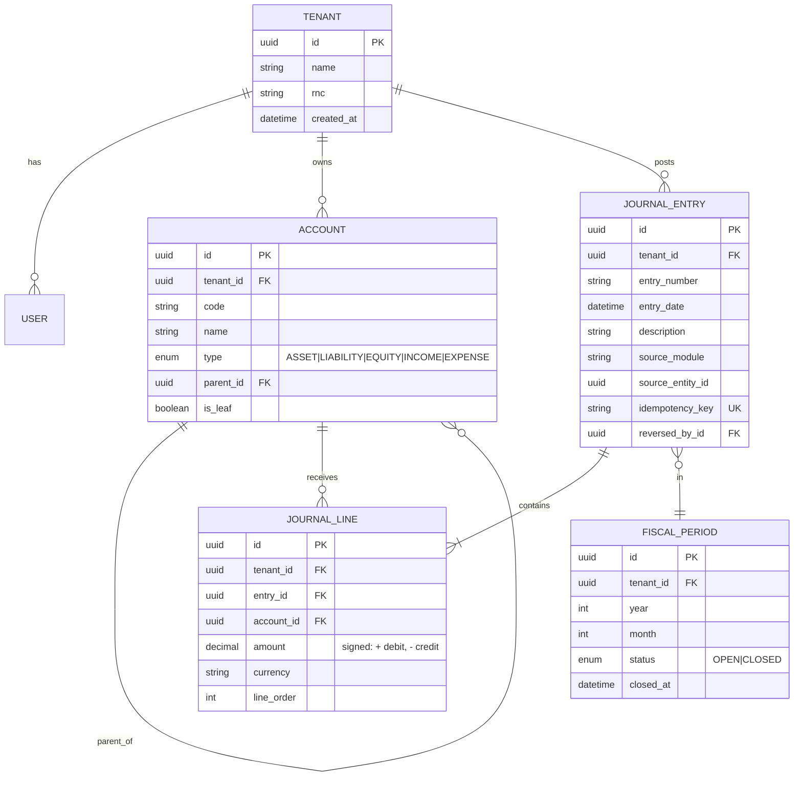
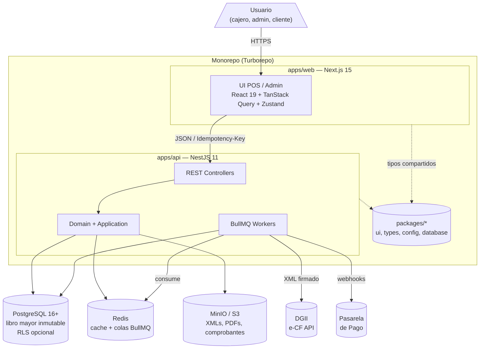
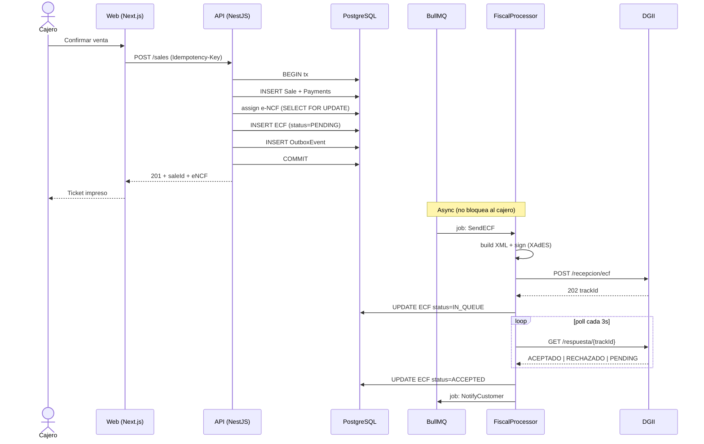
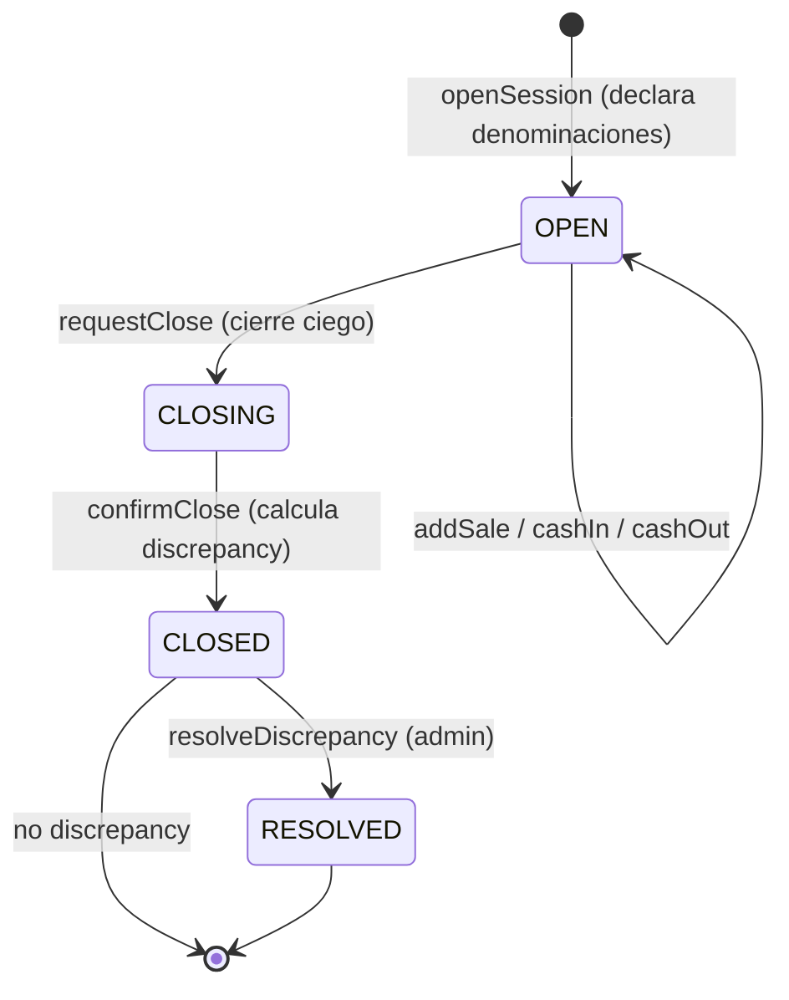
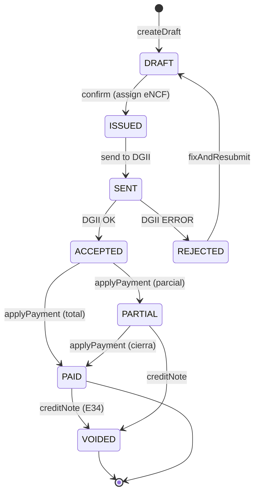
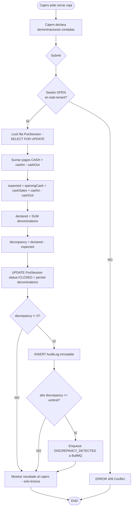
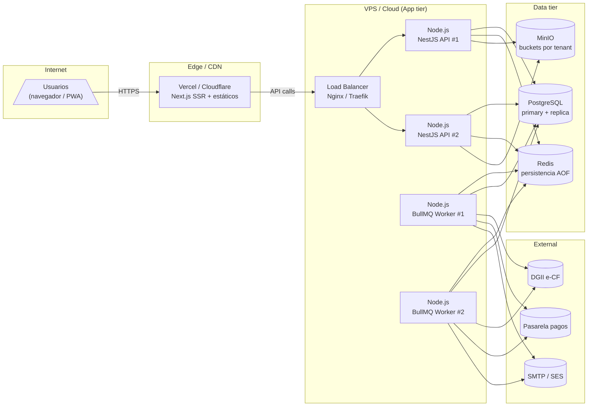

# 10 — Diagramas Mínimos Antes de Programar

## Filosofía: documentar lo justo, no todo

Generar los 8 diagramas formales por cada módulo es sobre-ingeniería. TypeScript estricto + Clean Architecture ya documentan implícitamente gran parte del comportamiento.

---

## Priorización real

### Innegociables (hacer SIEMPRE)

| Diagrama                      | Cuándo                                            | Herramienta                        |
| ----------------------------- | ------------------------------------------------- | ---------------------------------- |
| **ERD** (Entidad-Relación)    | Antes del `schema.prisma` de cada Bounded Context | Mermaid `erDiagram` o dbdiagram.io |
| **C4 Contenedores** (Nivel 2) | Una vez por proyecto, actualizar al sumar infra   | Mermaid `flowchart` o Structurizr  |

### Situacionales (solo si la complejidad lo justifica)

| Diagrama                  | Cuándo justificarlo                                                      |
| ------------------------- | ------------------------------------------------------------------------ |
| **Diagrama de Secuencia** | Flujos asíncronos críticos con varios actores (DGII e-CF, login con SSO) |
| **Diagrama de Estados**   | Entidad con ciclo de vida no trivial (factura, pedido, sesión de caja)   |
| **Diagrama de Actividad** | Lógica condicional densa antes de programarla                            |

### Omitir en el día a día

| Diagrama                 | Por qué                                  |
| ------------------------ | ---------------------------------------- |
| C4 Contexto (Nivel 1)    | Útil para stakeholders, no para devs     |
| C4 Componentes (Nivel 3) | Clean Architecture ya lo dicta           |
| Despliegue               | Solo al setup inicial y cambios de infra |

---

## Plantilla: ERD en Mermaid



> Reglas para tu ERD:
>
> - Cada entidad tenant-aware debe tener `tenant_id` y aparece en `@@unique` o `@@index`.
> - Marcar `UK` (unique) en campos como `idempotency_key`.
> - Mostrar tipo de dato (`decimal`, `enum`) para campos críticos.
> - Comentar campos no obvios (ej. `amount "signed: + debit, - credit"`).

---

## Plantilla: C4 Contenedores



---

## Plantilla: Diagrama de Secuencia (e-CF a DGII)



---

## Plantilla: Diagrama de Estados (Sesión de caja)



---

## Plantilla: Diagrama de Estados (Factura E31)



---

## Plantilla: Diagrama de Actividad (Cierre ciego)



---

## Plantilla: Diagrama de Despliegue (referencia inicial)



---

## Dónde guardar los diagramas

```
docs/
  architecture/
    01-contenedores.md       ← C4 Nivel 2 (mermaid)
    02-deployment.md         ← Despliegue
  modules/
    accounting/
      erd.md                 ← Mermaid ERD del módulo
      sequence-post-entry.md ← Si el flujo lo amerita
      state-journal.md       ← Si la entidad tiene estados
    pos/
      erd.md
      activity-blind-close.md
      state-pos-session.md
    fiscal-dgii/
      erd.md
      sequence-ecf.md
```

Convención: cada `.md` empieza con un párrafo de contexto + el bloque Mermaid + un párrafo de "decisiones clave" debajo.

---

## Auto-validación: ¿el diagrama está completo?

| Pregunta                                           | ERD | Secuencia | Estados | Actividad |
| -------------------------------------------------- | --- | --------- | ------- | --------- |
| ¿Aparece `tenantId`?                               | ✓   | —         | —       | ✓         |
| ¿Restricciones únicas marcadas?                    | ✓   | —         | —       | —         |
| ¿Tipos de campo críticos (Decimal, enum) visibles? | ✓   | —         | —       | —         |
| ¿Actores externos identificados?                   | —   | ✓         | —       | —         |
| ¿Operaciones async marcadas como tales?            | —   | ✓         | —       | ✓         |
| ¿Cada transición tiene evento + condición?         | —   | —         | ✓       | —         |
| ¿Estado final `[*]` definido?                      | —   | —         | ✓       | —         |
| ¿Decisiones binarias en rombos?                    | —   | —         | —       | ✓         |
| ¿Path de error trazado?                            | —   | ✓         | ✓       | ✓         |
